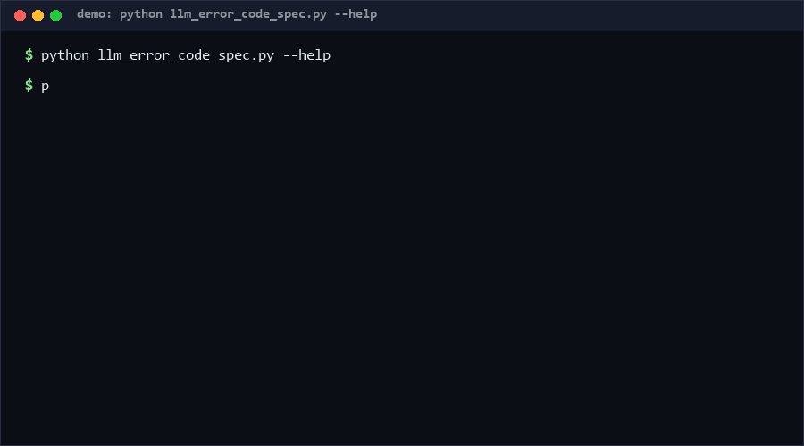

# llm-error-code-spec

A canonical error-code registry for LLM gateways: a six-class taxonomy
(auth / quota / transient / input / upstream / internal), stable `E####`
codes mapped to HTTP statuses and process exit codes, plus a validator and
mapping CLI. Ship one registry, get consistent exit codes across scripts,
CI jobs and agents. Pure standard library. *No direct equivalent found as of
2026-10-13.*

<p align="center"></p>

## Problem

Every LLM gateway script reinvents failure handling: 429 sometimes maps to
exit 1, sometimes 3, sometimes a crash. Wrappers cannot branch on errors,
on-call cannot grep logs, and "retryable" lives in tribal knowledge. The
missing artifact is a single, validated registry that binds taxonomy → HTTP
status → exit code → retryability once, so all consumers agree.

## How it works

A **registry** is JSON: a list of codes, each with `code` (`E\d{4}`),
snake_case `name`, `class` (one of six), `http` (400–599), `exit` (2–125),
`retryable` flag, and a human `description`. The validator enforces
uniqueness (code/name/http/exit), class coverage, and class-retryability
consistency (only transient/quota/upstream may be retryable) — rules
R1–R11. `map` resolves an HTTP status or name to its entry and resolved exit
code; unknown statuses fall back to `default_exit`.

## Quickstart

```console
$ python llm_error_code_spec.py validate registry.json
OK
$ python llm_error_code_spec.py map registry.json --http 429
E4290 rate_limited class=quota http=429 exit=8 retryable=True
```

Validation is <1ms; 100k map lookups take ~0.3s [Measured] — exit-code
mapping is safe inside hot retry loops.

## Why not X

No tool with the same scope surfaced during research (checked 2026-10-13),
but adjacent solutions exist:

- **Vendor SDK error classes** (openai, anthropic client libs) — per-vendor
  exception types with no cross-vocabulary mapping and no exit-code story;
  also unversioned between SDK releases.
- **HTTP status codes alone** — too coarse: 429 covers hard quota and
  momentary rate limiting; 5xx hides retryability differences.
- **JSON Schema / protobuf error enums** — validate or transmit structure,
  but do not enforce cross-field invariants (unique exits, retryable-by-class)
  or ship a mapping CLI.
- **gRPC status codes** — a competing taxonomy with different granularity,
  no process-exit semantics.

## Performance

All numbers [Measured] locally (Python 3.13, Windows 10, single core):

| Workload | Result | Command |
|---|---|---|
| 100,000 map lookups | 0.296s (338k lookups/s) | `python llm_error_code_spec.py bench --lookups 100000` |
| Registry validation (10 codes) | <1ms | `python llm_error_code_spec.py validate registry.json` |

## Minimal Fallback

A 15-line table in your repo (code, http, exit, retryable) plus one function
that reads it. You lose uniqueness/coverage validation and the mapping CLI —
which is exactly where hand-maintained tables drift.

## Design Trade-offs

- **One code per HTTP status.** Guarantees deterministic mapping; fine
  distinctions (quota vs rate limit) must share a code or pick a status.
- **Exit codes 2–125.** Reserves 0/1 for shell conventions and >125 for
  signal deaths, so registry exits never collide with runtime exits.
- **Retryability is class-checked, not code-specific lore.** A code in the
  `input` class cannot be retryable — validation rejects it outright.
- **Flat JSON over protobuf/YAML.** Greppable, diffable, zero deps; the
  format is deliberately boring.

## Limits & Second-order Effects

- Codes are gateway-centric; provider-side outage classification still
  requires a human reading the upstream error body.
- Registry evolution needs discipline: retiring an exit code breaks scripts
  that branch on it (document removals in CHANGELOG).
- Six classes will not fit every org; the validator rejects unknown classes
  by design, so extension is a schema change, not a footnote.
- `default_exit` masks unmapped statuses — configure it deliberately, not
  by accident.

## FAQ

**When NOT to use this?** Not for user-facing error *messages* (i18n is a
different layer), not inside the provider itself (you own the status codes
there), and not where gRPC/HTTP2 status is already your contract.

**Why `E####` and not UUIDs?** Codes appear in logs and shell sessions;
they must be short, typeable and greppable.

**Can two codes share an HTTP status?** No — mapping must be deterministic.

**Is the bundled sample registry production data?** No. It is a generic,
vendor-neutral example; bring your own registry.

## [Core Assumptions]

1. Every gateway error can be observed as an HTTP status at the consumer
   boundary.
2. Process exit codes are the primary machine-consumable channel for
   scripts and CI.
3. Retryability is a property of the error class, decided at design time,
   not inferred at runtime.

Confidence: high in validator/mapping behavior (self_test.py, 62 cases);
medium that six classes cover real gateways — the taxonomy is small on
purpose. As of 2026-10-13.

---

Part of the [zhengming-toolbox](https://github.com/chenhz01/zhengming-toolbox) — 105 purpose-built AI-engineering tools across neglected niches.

Related tools: [context-truncation-bench](https://github.com/chenhz01/context-truncation-bench) · [adr-staleness-check](https://github.com/chenhz01/adr-staleness-check) · [agent-stop-condition-spec](https://github.com/chenhz01/agent-stop-condition-spec)
